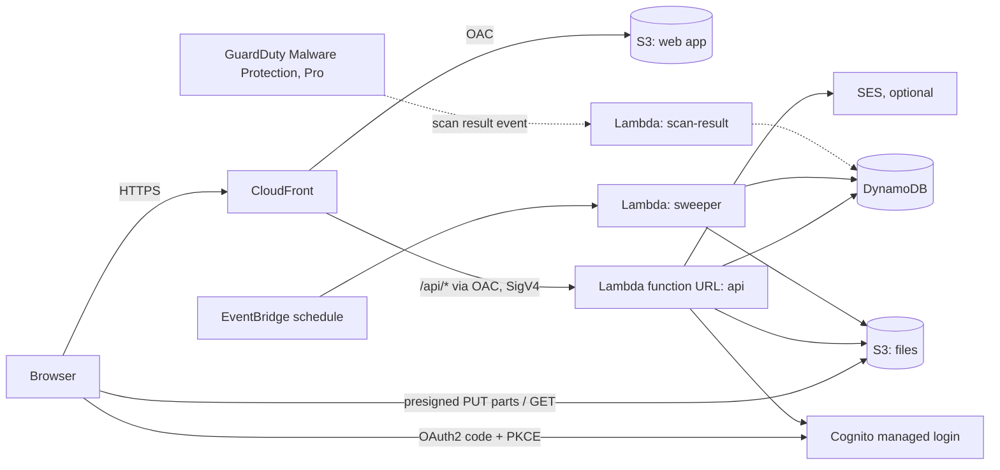

# Sendless architecture

Status: **accepted** (2026-10-24). Changes are recorded in the decision log at the end.

## Goals

- **Fully serverless.** Nothing to patch or scale, and close to zero cost when idle.
- **One-click deploy.** A CloudFormation quick-create link that works in any commercial AWS Region, with no us-east-1 dependency. The one exception is CloudFront's rule that a custom-domain certificate must live in us-east-1.
- **Your account, your data.** Files, metadata and logs stay in the deployment Region. There is no phone-home. Release artifacts are pinned by SHA-256.
- **Recipients need no account.** Senders and admins sign in.
- **Clean install and uninstall.** Deleting the stack removes everything.
- **Auditable.** One readable template and least-privilege IAM.
- **Open core.** Apache-2.0, except `ee/`, which is commercial and unlocked with a license key.

## Overview



## Decisions

| # | Decision | Choice | Why | Main alternative |
|---|----------|--------|-----|------------------|
| 1 | Infrastructure as code | **Plain CloudFormation YAML, one file** | Customers' security teams read it. A quick-create link needs one template. No SAM transform and no CDK bootstrap. | CDK, whose generated template is hard to audit and needs a custom synthesizer for one-click |
| 2 | Shipping code for one-click | **Template pins the version and SHA-256 of `backend.zip` and `web.zip`.** A tiny inline bootstrap Lambda downloads them from `ArtifactBaseUrl` into a bucket the stack owns. All functions are normal CloudFormation resources. | Works in every Region from one public location. Can be mirrored for air-gapped setups. The supply chain is verifiable. No more patching the distribution outside CloudFormation. | A vendor bucket in each of 30+ Regions |
| 3 | API front door | **CloudFront → Lambda function URL with OAC** (AuthType `AWS_IAM`) | The function can only be reached through CloudFront, a real lock unlike the old shared header. No API Gateway cost and no 29 s timeout. Same origin, so no CORS. | API Gateway HTTP API with JWT authorizer |
| 4 | API shape | **One API Lambda with an internal router** | One artifact, fewer cold starts, simple IAM. Can be split later. | One Lambda per route, as in v1 |
| 5 | Sender auth | **Cognito user pool with managed login. The SPA uses OAuth2 code + PKCE.** Admins invite users. Optional self sign-up restricted to email domains. Group `admins`. | Native, free up to large user counts, MFA built in. Pro SSO plugs into the same pool. | Custom login UI that talks to Cognito directly |
| 6 | Recipient access | **128-bit random link IDs.** Unlocking a transfer counts as one *open*, via an atomic conditional update, and starts a 1 h session. Each file then gets a 5-minute presigned GET with `Content-Disposition` set when it's downloaded. Passwords are hashed server-side with scrypt; each link accepts at most 10 password attempts per 15 min, each claimed atomically before the check. | Atomic limits and no client-side hashing. File names stay hidden until unlock. | Counting each file download separately |
| 7 | Uploads | **S3 multipart with presigned part URLs for every file.** 4 parallel parts, retries, up to 5 TB per file. Size is checked after completion, because presigned URLs can't enforce length. **No zipping in the browser.** | Large files work and failed parts are retried. The browser no longer runs out of memory. | Single PUT, limited to 5 GB, as in v1 |
| 8 | Multiple files | Recipients download files one at a time or use **"Download all"** (one after another). | Simple and robust. | Server-side ZIP (later) |
| 9 | Request-files links (core) | A public upload page for outsiders. Each submission becomes an **inbound transfer** owned by the person who created the request. | One data model and one download path. | — |
| 10 | Data | **One DynamoDB table** (on-demand, point-in-time recovery, TTL). See the data model below. | Cheap at idle, no capacity planning. | Several tables |
| 11 | Cleanup guarantees | A **sweeper** runs every 15 min and deletes the objects of expired or used-up transfers. An **S3 lifecycle** rule hard-expires anything older than `MaxRetentionDays` and aborts unfinished multipart uploads after 1 day. Deleting the stack empties the buckets. | "Expired" means deleted, and there's a hard upper bound even if the sweeper fails. | DynamoDB TTL streams, which can lag up to days |
| 12 | Edge logic | **No Lambda@Edge.** SPA routing uses a CloudFront Function. Security headers (CSP, HSTS, …) use a response headers policy. | Everything stays in the deployment Region, which is required for the data-residency pitch and for the European Sovereign Cloud. | Lambda@Edge, as in v1 |
| 13 | Download transport | **S3 presigned URLs** on the bucket's regional domain. | No key management. | CloudFront signed URLs on the app domain (later option) |
| 14 | Email | **Optional SES.** The `SenderEmail` parameter names an identity the customer has verified. Without it, users copy and paste links. Cognito invites use Cognito's built-in email. | Works out of the box, and email is easy to add later. | — |
| 15 | Open core | Apache-2.0 everywhere except `ee/`, which is commercial. Pro features check a **license key: an Ed25519-signed JWS verified offline** with a public key embedded in the code. The key is entered in the admin UI. | No phone-home, and works air-gapped. Same model as GitLab EE. | Separate private Pro build |
| 16 | Frontend | **React + Vite + TypeScript SPA**, no UI framework. CSS variables are themed from the admin branding settings. **English and German, light and dark theme.** | Small bundle, and branding can be changed at runtime. | — |
| 17 | Local development | The API is split into core logic and swappable adapters for AWS services. `npm run dev` runs the real API with an in-memory database, a local file store and fake login. | Contributors can run the whole app without AWS, and the UI can be tested end to end. | Requires an AWS account to try |
| 18 | Runtime | **Node.js 22, arm64**, bundled with esbuild, AWS SDK v3 bundled | About 20 % cheaper on arm64, and the bundle is reproducible. | — |

## Repository layout

```
sendless/
├─ template/sendless.yaml     CloudFormation template (one-click)
├─ packages/
│  ├─ shared/                 API types and zod schemas (used by api and web)
│  ├─ api/                    Lambda handlers: api, sweeper, setup, pre-sign-up; dev server
│  └─ web/                    React SPA
├─ ee/                        Pro features, commercial license (see ee/LICENSE)
│  ├─ api/                    license check, SSO, malware scan, audit export, policies
│  └─ web/                    admin screens for the above
├─ scripts/                   build, release (writes checksums into the template), publish
└─ docs/
```

## API

The API is served from the same origin under `/api`. Authenticated calls send the Cognito access token in `X-Sendless-Token`, because CloudFront's OAC replaces `Authorization`. POST, PUT, PATCH and DELETE requests send `x-amz-content-sha256`, which the SPA's API client adds automatically.

**Public (no login):**
- `GET  /api/public/config`: branding, enabled features, limits
- `GET  /api/public/transfers/{id}`: title, message, expiry, whether a password is needed
- `POST /api/public/transfers/{id}/unlock`: password check, counts one open, returns a session and the file list
- `POST /api/public/transfers/{id}/files/{fileId}/download`: presigned GET (needs the session)
- `GET  /api/public/requests/{id}` and `POST /api/public/requests/{id}/submissions`
- `POST /api/public/uploads/{transferId}/files/{fileId}/parts | complete`, and `POST /api/public/uploads/{transferId}/finalize`, authorized by the upload token returned when the transfer is created

**Signed in:**
- `GET /api/me`
- `GET|POST /api/transfers`
- `GET|DELETE /api/transfers/{id}`
- `POST /api/transfers/{id}/files/{fileId}/download`
- `GET|POST /api/requests`
- `DELETE /api/requests/{id}`

**Admin:**
- `GET|PUT /api/admin/settings`
- `GET|POST /api/admin/users`
- `PATCH|DELETE /api/admin/users/{username}`
- `PUT /api/admin/license`

**Pro (`ee/`):**
- `GET /api/admin/audit` (with export)
- `GET|PUT /api/admin/policies`
- `GET|POST|DELETE /api/admin/sso/providers`
- the malware scan-result handler

## Data model (single table)

| Item | PK | SK | Notes |
|------|----|----|-------|
| Transfer | `TRANSFER#{id}` | `META` | `kind` (outbound/inbound), owner, files[], expiresAt, maxOpens, opens, passwordHash, status, uploadToken. GSI1 lists by owner; GSI3 indexes active transfers by expiry |
| Event | `TRANSFER#{id}` | `EVT#{ts}#{eid}` | Activity per transfer (core). GSI2 by day for the admin-wide audit log (Pro) |
| Request | `REQUEST#{id}` | `META` | Inbound link: owner, limits, expiry, passwordHash. GSI1 and GSI3 |
| Session | `SESSION#{id}` | `META` | Recipient session after unlock. TTL 1 h |
| Settings | `SETTINGS` | `GLOBAL` | Branding, defaults, license key, Pro policies |

## Security model

| Threat | Mitigation |
|--------|-----------|
| Guessing links | 128-bit random IDs. Public responses don't reveal whether an ID existed. |
| Brute-forcing passwords | Server-side scrypt. At most 10 attempts per link per 15 min, claimed atomically so parallel requests cannot exceed it. Optional AWS WAF later. |
| XSS (v1 had stored XSS through file names) | React escapes everything, a strict CSP is set, and no `innerHTML`. |
| Bypassing CloudFront | Function URL with `AWS_IAM` plus OAC, restricted to this distribution's ARN. |
| Leaked or forwarded links | Expiry, open limits, revoke, and an activity log per transfer. |
| Malicious uploads | Pro: GuardDuty scanning, with downloads blocked until a file is clean. |
| Abuse of public request links | Unguessable ID, expiry, optional password, and limits on size and submission count. |
| Secrets in logs (v1 logged passwords) | Structured logging that never logs request bodies or tokens. |
| Stale data | Sweeper plus the S3 lifecycle hard limit. Stack deletion empties the buckets. |

## Decision log

**Decided with the product owner**

| Date | Decision |
|------|----------|
| 2026-10-24 | Architecture accepted. API front door: Lambda function URL + CloudFront OAC. Download limits count *opens* (one unlock = one open, then 1 h to fetch all files). The code lives in its own git repository. |
| 2026-10-24 | Backend in TypeScript. Pro is gated by an offline-verified signed license key, with Pro code in `ee/` of the same repo. Pro features: SSO, malware scanning, audit export & policies; file requests stay in the core. Core license: Apache-2.0. |
| 2026-10-25 | SSO providers are configured at runtime from the admin UI, and the license is checked there. Because a stack update can reset the Cognito app client's provider list, the setup custom resource re-applies it after every deploy. |
| 2026-10-25 | Files GuardDuty cannot scan (e.g. encrypted archives) are blocked by default. The Pro policy `allowUnscannableFiles` lets admins allow them. Infected files are always blocked and deleted. |

**Made during implementation (open for review)**

| Topic | Decision | Reason |
|-------|----------|--------|
| API token | The SPA sends the Cognito **ID token** in `X-Sendless-Token`. | Access tokens carry no email address, and CloudFront OAC replaces `Authorization`. |
| Deploy-time config | User pool, client ID and app URL are written to a `SYSTEM` item in DynamoDB by the setup custom resource, not to Lambda environment variables. | Breaks the CloudFormation cycle CloudFront → function URL → function → user pool → CloudFront. |
| Files bucket name | Derived from account, Region and stack ID (`sendless-files-…`). | Lets the CSP and IAM policies reference the bucket without creating a dependency cycle through CloudFront. |
| Transfer lifetime | Counted from upload **completion**. Uploads must finish within 24 h. | A 2-hour link should not expire while a large upload is still running. |
| Recipient session | A random session ID stored in DynamoDB with TTL, not a signed token. | No secrets to generate, store or rotate. |
| File names | Path separators are replaced with `_` instead of being stripped. Control and invisible formatting characters (e.g. right-to-left overrides) and trailing dots and spaces are removed, and the blocked-file-type policy checks this cleaned name. | Found in browser testing: `notes <b>bold</b>.txt` lost its prefix. Found in review: `setup.exe\u0001` passed the policy and was stored as `setup.exe`. Storage keys never use names. |
| License expiry | 14-day grace period with a warning, then Pro switches off. SSO providers already set up keep working. | An expired invoice should never lock users out of their files. |
| Lifecycle backstop | `MaxRetentionDays` is limited to fixed values, and a mapping adds 2 days for the S3 rule. | CloudFormation has no arithmetic. |
| Bootstrap code | The inline artifact downloader is Python. Everything else is TypeScript. | Inline Lambda code is limited to 4 KB, and Python's standard library has HTTPS, SHA-256 and the CloudFormation response helper built in. |
| Rate limiting | No reserved concurrency by default. Brute force is handled by per-link lockout. | New AWS accounts have very low concurrency quotas, and reserving some would break deployment. AWS WAF is a later option. |
| Cognito email | Invitations use Cognito's built-in email even when SES is configured. | Configuring Cognito with SES needs the exact identity ARN (address or domain), and a wrong guess fails the deployment. |
| Dev mode Pro | `npm run dev:pro` trusts a throwaway key **inside the dev server process** only. | Lets contributors build Pro screens without real keys. The Lambda handlers never call it. |
| OAC body hash | `x-amz-content-sha256` is **not** in the API origin request policy. | Found on the first AWS deploy: CloudFront rejects it there and forwards it for the OAC signature by itself. |
| Custom resource replies | The inline bootstrap answers CloudFormation with its own HTTPS PUT instead of `cfnresponse`. Custom resources set `ServiceTimeout`. | Found on the first AWS deploy: `cfnresponse` is not provided for inline Python 3.13, and a crash then hung the stack for an hour. `scripts/check-bootstrap.py` now guards this in CI. |
| Password attempts | Each attempt is claimed with one conditional write **before** the scrypt check: at most 10 per link in a 15-minute window that starts with the first attempt. A correct password gives the window's attempts back. | Found in review: checking the lock before the slow hash let 60 parallel guesses all through. One write per claim leaves no state a crash could lock for good. |
| Settings writes | Every change is a read-modify-write of the stored settings with a `version` attribute and a conditional put (retried), never based on the per-container cache. | Found in review: a save on a Lambda container with a cached copy reverted policies saved on another container a few seconds earlier. |
| Deleting a user | Closes the user's active file requests and transfers and deletes their files, then deletes the account. | Nobody could manage or revoke those links afterwards. Closing first means a failure part-way can be retried. Disabling a user keeps everything. |
| Dark theme | Follows the system setting, with a per-browser switch in the footer. The admin's background and text colors apply to the light theme only. A tiny external script sets the theme before the first paint. | The CSP allows no inline scripts; without it the dark theme would flash light. |

**Verified on AWS** (2026-10-25, eu-central-1, test account): create, the 18-check e2e suite including GuardDuty/EICAR and the sweeper, a browser upload and download through the deployed site (CORS, CSP), the managed login redirect, an upgrade from 1.0.0 to 1.0.1 with data preserved, and deletion with no leftovers among 47 resources.

## Out of scope for v1

- Server-side ZIP of all files
- CloudFront signed downloads on the app domain
- AWS WAF
- End-to-end (in-browser) encryption
- Outlook add-in
- The vendor-side license-issuing service connected to Marketplace SaaS fulfillment (a separate private repo)
